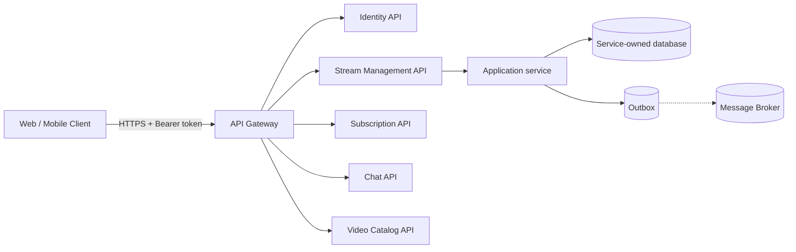
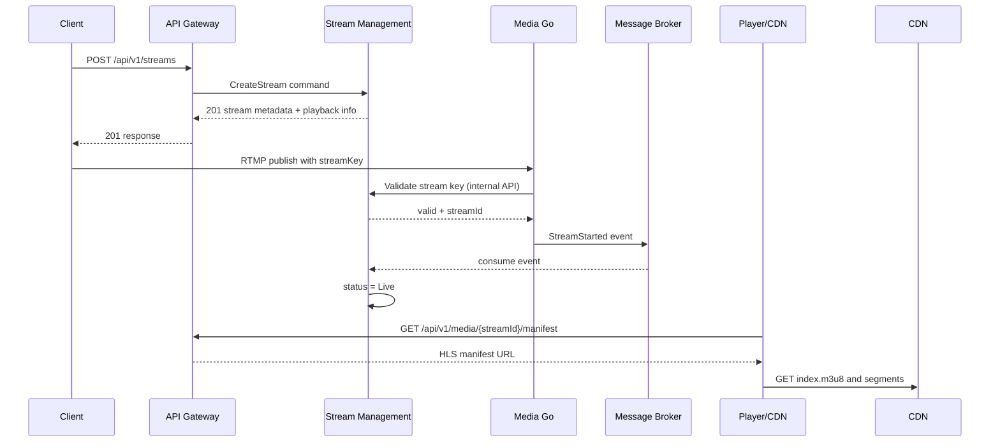

# API Contracts and Service Boundaries

> Issue #81 — design the external HTTP contracts before extracting services.

## Purpose

This document defines the first stable API boundary for the migration. It separates transport concerns from business logic and records which service owns each endpoint.

The current monolith remains the implementation. The contract is the target boundary that future services must preserve.

## Request flow



Controllers should validate the request, create a command/query, call the application layer, and map the result. They should not contain SQL, domain workflows, or direct calls to another service's database.

## Versioning and headers

- Public routes use `/api/v1/...`.
- `Authorization: Bearer <access-token>` is required for protected operations.
- `X-Correlation-ID` is accepted from the caller or generated at the gateway.
- `X-Request-ID` identifies one HTTP request when a separate request identifier is needed.
- Mutating endpoints should accept `Idempotency-Key` when a retry could create a duplicate resource or command.
- JSON responses use `application/json`; errors use `application/problem+json`.

## Ownership and routes

| Service | Resource | Initial routes | Access |
|---|---|---|---|
| Identity | authentication | `POST /api/v1/auth/register`, `POST /api/v1/auth/login`, `POST /api/v1/auth/refresh`, `POST /api/v1/auth/logout` | public/authenticated |
| Identity | current user | `GET /api/v1/users/me`, `PATCH /api/v1/users/me` | authenticated |
| Stream Management | streams | `POST /api/v1/streams`, `GET /api/v1/streams/{streamId}`, `GET /api/v1/streams/{streamId}/status`, `GET /api/v1/streams` | authenticated, policy-based |
| Stream Management | lifecycle | `POST /api/v1/streams/{streamId}/end` | owner/permission |
| Media | playback | `GET /api/v1/media/{streamId}/manifest` | public or entitlement-checked |
| Chat | messages | `GET /api/v1/streams/{streamId}/messages`, `POST /api/v1/streams/{streamId}/messages`, `DELETE /api/v1/messages/{messageId}` | authenticated where required |
| Chat | realtime | `wss://.../hubs/chat` | authenticated |
| Subscription | plans/subscriptions | `GET /api/v1/plans`, `POST /api/v1/subscriptions`, `DELETE /api/v1/subscriptions/{id}` | authenticated |
| Video Catalog | videos | `GET /api/v1/videos/{videoId}`, `GET /api/v1/streams/{streamId}/videos` | public/authenticated by policy |

RTMP is not an HTTP controller route. A publisher connects to the Media Service using `rtmp://host/live/{streamKey}`. HLS is delivered as HTTP media data through CDN, not through Stream Management.

## API response shape

Successful responses may return the resource directly while the contract is being stabilized. For new public endpoints, prefer an explicit envelope so metadata can be added without breaking clients:

```json
{
  "data": {
    "streamId": "8b1f4a4b-2b5c-4cf6-8ac1-1a3d3f7d4e91",
    "title": "Demo stream",
    "status": "Preparing"
  },
  "meta": {
    "correlationId": "01J...",
    "apiVersion": "v1"
  }
}
```

Do not return `streamKey`, refresh tokens, password hashes, internal database IDs, or infrastructure details in ordinary resource responses.

## Core DTO contracts

### Create stream

POST /api/v1/streams

Request:

~~~json
{
  "title": "Demo stream",
  "description": "Architecture demo",
  "category": "technology",
  "thumbnailUrl": "https://cdn.example.com/thumb.jpg"
}
~~~

Response: 201 Created

~~~json
{
  "data": {
    "streamId": "8b1f4a4b-2b5c-4cf6-8ac1-1a3d3f7d4e91",
    "title": "Demo stream",
    "description": "Architecture demo",
    "category": "technology",
    "status": "Preparing",
    "publishUrl": "rtmp://media.example.com/live",
    "playback": {
      "manifestUrl": "https://cdn.example.com/hls/8b1f4a4b/index.m3u8"
    }
  },
  "meta": {
    "correlationId": "01J...",
    "apiVersion": "v1"
  }
}
~~~

The publish URL may be returned, but the secret streamKey must be shown only through a dedicated protected operation or one-time creation response. It must never appear in logs, events, metrics, or ordinary stream lists.

### Get stream

GET /api/v1/streams/{streamId}

Response: 200 OK

~~~json
{
  "data": {
    "streamId": "8b1f4a4b-2b5c-4cf6-8ac1-1a3d3f7d4e91",
    "title": "Demo stream",
    "category": "technology",
    "ownerId": "user-123",
    "status": "Live",
    "startedAt": "2026-10-24T09:30:00Z"
  },
  "meta": {
    "correlationId": "01J...",
    "apiVersion": "v1"
  }
}
~~~

### Get playback manifest

GET /api/v1/media/{streamId}/manifest

Response: 200 OK

~~~json
{
  "data": {
    "streamId": "8b1f4a4b-2b5c-4cf6-8ac1-1a3d3f7d4e91",
    "protocol": "hls",
    "manifestUrl": "https://cdn.example.com/hls/8b1f4a4b/index.m3u8",
    "expiresAt": "2026-10-24T10:00:00Z"
  },
  "meta": {
    "correlationId": "01J...",
    "apiVersion": "v1"
  }
}
~~~

The Media Service may return a signed, time-limited URL. The client should use that URL for playback rather than asking Stream Management for HLS files.

### End stream

POST /api/v1/streams/{streamId}/end

Response: 202 Accepted when Media must stop asynchronously, or 204 No Content when the operation is completed synchronously. The selected behavior must be consistent and documented by the owning service.

## Standard errors

```json
{
  "type": "https://api.streamingproject.dev/problems/stream-not-live",
  "title": "Stream is not live",
  "status": 409,
  "detail": "The stream must be live before a viewer can join.",
  "instance": "/api/v1/streams/8b1f4a4b-2b5c-4cf6-8ac1-1a3d3f7d4e91/join",
  "traceId": "4bf92f3577b34da6a3ce929d0e0e4736"
}
```

| Situation | HTTP status |
|---|---:|
| invalid input | `400` |
| missing/invalid token | `401` |
| authenticated but forbidden | `403` |
| resource missing | `404` |
| invalid state or duplicate idempotency key | `409` |
| accepted for asynchronous processing | `202` |
| dependency unavailable | `503` |

## Critical stream scenario



## Current implementation mapping

The current controllers use `api/[controller]` and return application results through `ApiControllerBase.HandleResult`. During migration, these routes should be moved behind the versioned gateway contract without changing domain behavior in the same task.

The first extraction should preserve:

1. authorization behavior;
2. response status semantics;
3. validation rules;
4. correlation and trace information;
5. idempotent behavior of mutating operations.

The current StreamsController already maps to the target responsibilities:

| Current code | Target contract |
|---|---|
| CreateStream(CreateStreamRequestDto) | POST /api/v1/streams |
| EndStream(streamId) | POST /api/v1/streams/{streamId}/end |
| GetStreamById(streamId) | GET /api/v1/streams/{streamId} |
| GetStreamStatus(streamId) | GET /api/v1/streams/{streamId}/status |
| GetHlsUrl(streamId) | GET /api/v1/media/{streamId}/manifest |
| GetAvailableStreams(request) | GET /api/v1/streams |

This mapping is documentation only. Do not rename all routes in the monolith while defining the contract; route migration belongs to the Gateway/extraction work.

## Definition of done

- Every public endpoint has an owning bounded context.
- New routes use `/api/v1` naming.
- Request and response DTOs are documented separately from domain entities.
- Errors use one documented problem format.
- Secrets and infrastructure details are excluded from responses.
- RTMP, REST, WebSocket/SignalR, and HLS responsibilities are explicitly separated.

## Next step

Define the event envelope and domain events in Issue #82, then add an Outbox design in Issue #84.
