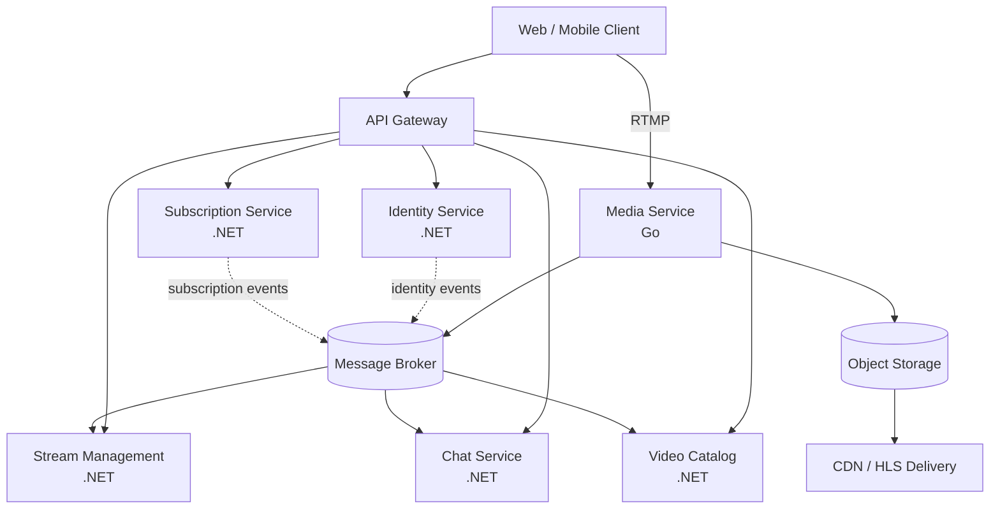
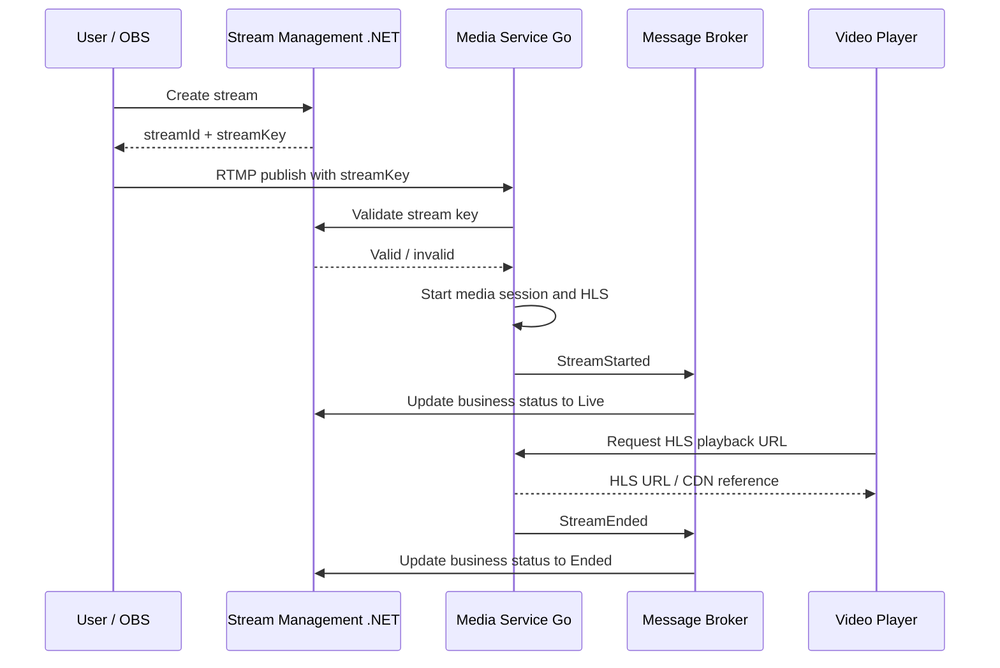

# Bounded Contexts and Data Ownership

> Related issue: [#80](https://github.com/emil720a1/StreamingProject/issues/80)
>
> This document defines the first service boundaries for the migration from the current modular monolith.

## Goal

The goal is to define clear business boundaries before extracting code into separate processes.

Each future service must:

- own its business data;
- expose an explicit API or publish events;
- avoid direct access to another service's database;
- keep its internal domain model private.

## Proposed Contexts



## Context Responsibilities

| Context | Responsibility | Future service |
|---|---|---|
| Identity | users, credentials, roles, permissions, refresh tokens | Identity Service (.NET) |
| Stream Management | stream metadata, keys, ownership and business status | Stream Management (.NET) |
| Media | RTMP ingest, media sessions, FFmpeg and HLS generation | Media Service (Go) |
| Chat | messages, moderation commands and realtime delivery | Chat Service (.NET) |
| Video Catalog | recorded video metadata, visibility and playback references | Video Catalog (.NET) |
| Subscription | follows, plans and subscription lifecycle | Subscription Service (.NET) |

## Data Ownership

| Data | Owner | Other services receive it through |
|---|---|---|
| User profile | Identity | API or `UserCreated` event |
| Roles and permissions | Identity | token claims or authorization API |
| Stream metadata | Stream Management | API or stream events |
| Stream key | Stream Management | validation API; never broadcast as an event |
| Stream business status | Stream Management | `StreamStarted` / `StreamEnded` events |
| RTMP connection | Media | `StreamStarted` / `StreamEnded` events |
| Media session | Media | media API and operational events |
| HLS playlist and segments | Media / Object Storage | signed playback URL or CDN |
| Chat messages | Chat | chat API and realtime channel |
| Recorded video metadata | Video Catalog | catalog API and media events |
| Subscriptions | Subscription | subscription API and subscription events |

The same concept can be represented in multiple services as a small read model. That is not shared ownership. The owning service remains the only service allowed to change the authoritative record.

## Stream and Media Boundary

This is the most important boundary for the first extraction.

### Stream Management owns

- `streamId`;
- `streamKey`;
- title, description and category;
- stream owner;
- business status: `Preparing`, `Live`, `Ended`;
- business timestamps;
- permissions to create or end a stream.

### Media Service owns

- RTMP listeners and connections;
- media sessions;
- FFmpeg processes;
- transcoding state;
- HLS playlists and segments;
- technical connection errors and retry state.



## Service API Responsibilities

These are boundary-level contracts. Full request and response schemas belong in issue #81.

### Identity Service

```text
POST /api/v1/auth/login
POST /api/v1/auth/refresh
POST /api/v1/auth/logout
GET  /api/v1/users/{userId}
```

### Stream Management Service

```text
POST /api/v1/streams
GET  /api/v1/streams/{streamId}
POST /api/v1/streams/{streamId}/end
POST /internal/v1/streams/validate-key
```

### Media Service

```text
RTMP rtmp://media-service/live/{streamKey}
GET  /internal/v1/media/streams/{streamId}/playback
GET  /health
```

### Chat Service

```text
GET    /api/v1/streams/{streamId}/messages
POST   /api/v1/streams/{streamId}/messages
DELETE /api/v1/messages/{messageId}
SignalR /hubs/chat
```

### Video Catalog Service

```text
GET   /api/v1/videos/{videoId}
GET   /api/v1/streams/{streamId}/videos
PATCH /api/v1/videos/{videoId}
```

### Subscription Service

```text
POST   /api/v1/users/{userId}/subscriptions
DELETE /api/v1/users/{userId}/subscriptions/{targetUserId}
GET    /api/v1/users/{userId}/subscriptions
```

## Initial Domain Events

| Event | Producer | Consumers | Purpose |
|---|---|---|---|
| `UserCreated` | Identity | Stream, Chat, Subscription | create minimal read models |
| `StreamCreated` | Stream Management | Media, Catalog | announce a new stream |
| `StreamStarted` | Media | Stream, Catalog, Chat | indicate that media is live |
| `StreamEnded` | Media | Stream, Catalog, Chat | indicate that media stopped |
| `VideoPublished` | Video Catalog | Stream, Subscription | announce recorded content |
| `SubscriptionCreated` | Subscription | Stream, Catalog, Chat | update follower projections |
| `ChatMessageSent` | Chat | moderation or analytics | notify interested consumers |

Events describe facts that already happened. They are not direct commands to another service.

For example:

```text
StreamStarted = Media successfully started receiving and processing media.
```

It does not mean that another service must start the stream.

## Rules for Ownership

1. A service may read another service's data only through a documented API or event.
2. A service must not query another service's database directly.
3. Events contain identifiers and facts, not private database entities.
4. Secrets such as `streamKey` are never published in public events.
5. API contracts and event schemas are versioned.
6. Consumers must tolerate duplicate event delivery.
7. Each service may keep a local read model for data needed by its own queries.

## What This Task Does Not Implement

This task does not yet:

- create the Go Media Service;
- split the PostgreSQL database;
- introduce Kafka or RabbitMQ;
- implement API Gateway routing;
- move controllers or entities;
- implement the event envelope.

Those are separate implementation tasks after the boundaries are approved.

## Definition of Done

- [x] Bounded contexts are identified.
- [x] Responsibilities are assigned to contexts.
- [x] Data ownership is explicit.
- [x] Stream Management and Media boundaries are documented.
- [x] Initial API responsibilities are listed.
- [x] Initial domain events are listed.
- [x] Cross-service ownership rules are documented.
- [ ] Detailed REST contracts are defined in issue #81.
- [ ] Event envelope and schemas are defined in issue #82.

## Next Step

Proceed to issue #81 and define the detailed REST request/response contracts, including the common API response envelope and correlation ID rules.
