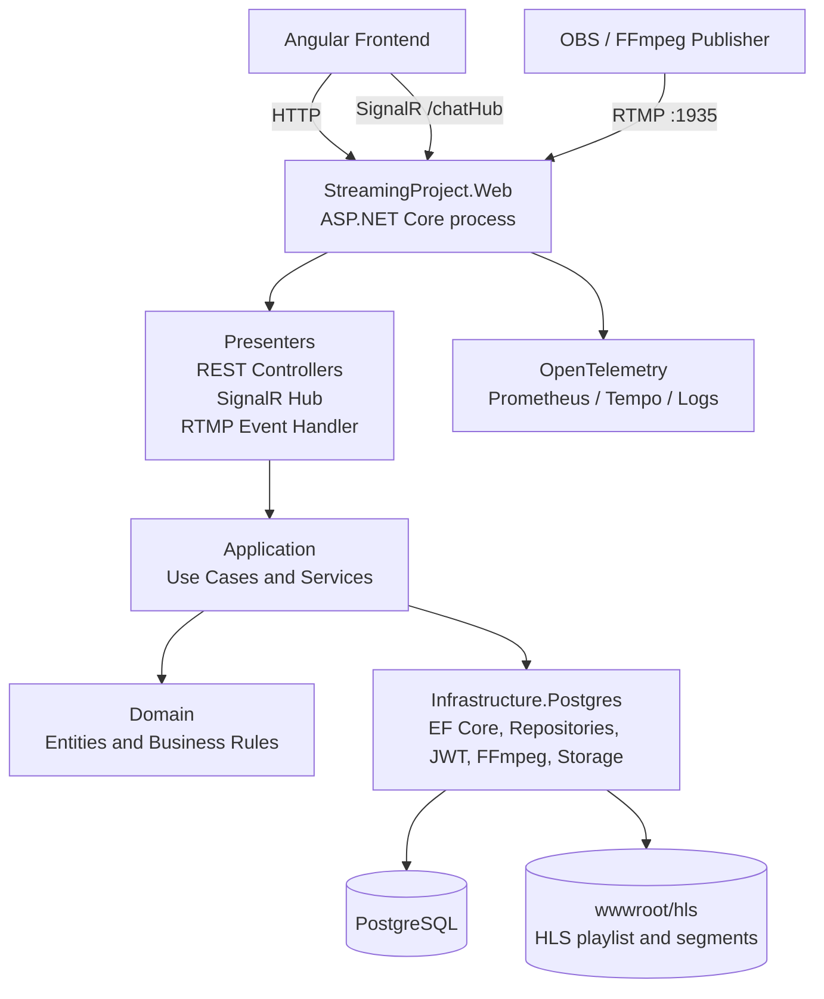
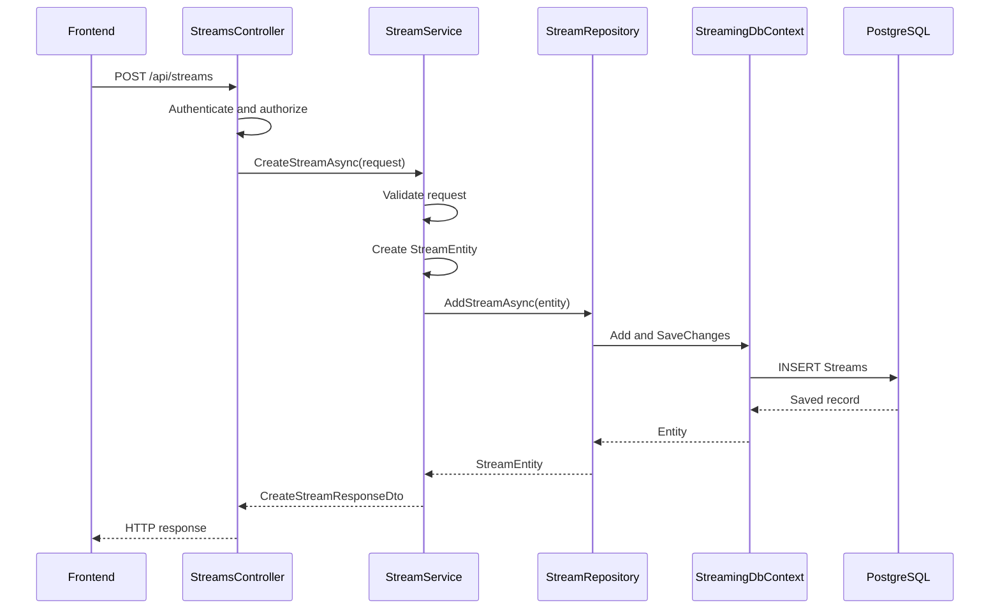
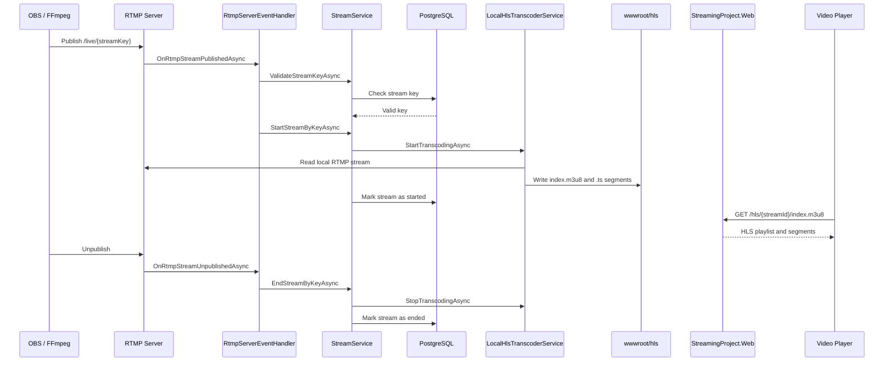
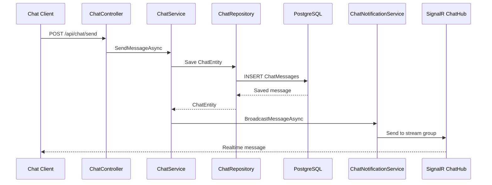
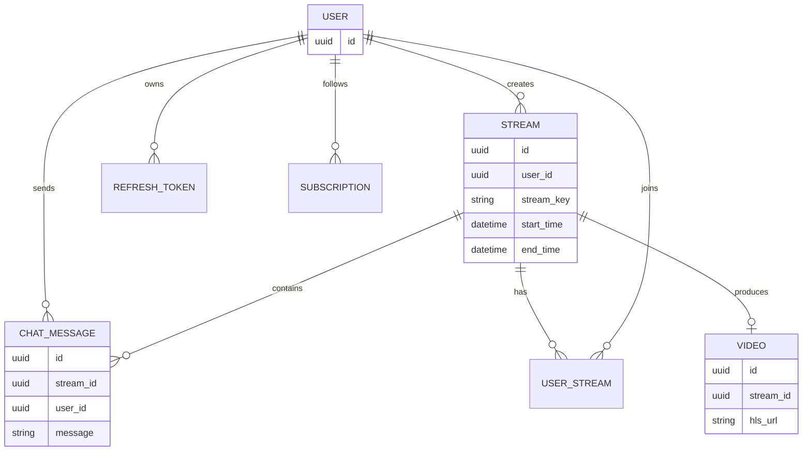
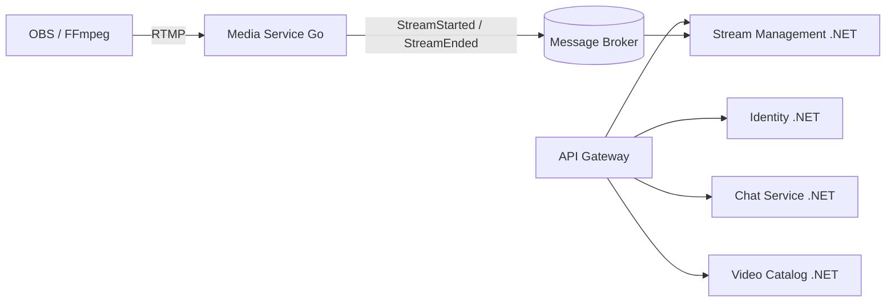

# Current Monolith Architecture

> Related issue: [#79](https://github.com/emil720a1/StreamingProject/issues/79)

## Purpose

This document describes the current architecture of StreamingProject before the migration to microservices.

The current system is a **modular monolith**: the application is deployed as one ASP.NET Core process, but the code is already divided into separate architectural layers and business modules.

The purpose of this document is to make the current dependencies visible before defining service boundaries.

## High-Level Architecture

## Runtime Entry Point

The application starts in `StreamingProject.Web/Program.cs`.

The Web project currently configures and hosts all major capabilities:

- ASP.NET Core HTTP pipeline;
- authentication and authorization;
- REST controllers;
- SignalR at `/chatHub`;
- RTMP server on port `1935`;
- HLS static files;
- PostgreSQL and Entity Framework Core;
- health checks at `/health`;
- Prometheus metrics;
- OpenTelemetry traces;
- development and production logging formats.

This means that one deployed process currently owns HTTP, realtime communication, RTMP lifecycle handling and HLS coordination.

## Project Layers

| Project | Responsibility | Examples |
|---|---|---|
| `StreamingProject.Domain` | Domain entities and rules | `StreamEntity`, `UserEntity`, `ChatEntity`, `VideoEntity` |
| `StreamingProject.Contracts` | API request and response DTOs | stream, chat, user and subscription contracts |
| `StreamingProject.Application` | Use cases and business orchestration | `StreamService`, `ChatService`, `UserService` |
| `StreamingProject.Infrastructure.Postgres` | Persistence and external infrastructure | `StreamingDbContext`, repositories, JWT, FFmpeg, storage |
| `StreamingProject.Presenters` | Delivery mechanisms | controllers, SignalR hub, RTMP event handler |
| `StreamingProject.Web` | Composition root and runtime host | `Program.cs`, middleware and dependency injection |
| `Shared` | Cross-cutting primitives | failures, errors, mappings and utilities |

## Main Business Modules

### Identity and Access

Responsible for users, authentication, refresh tokens, roles and permissions.

Main components:

- `AuthController`;
- `UsersController`;
- `RoleController`;
- `PermissionController`;
- JWT and cookie authentication;
- authorization policies such as `Permission.Read` and `Permission.Create`.

Potential future service: **Identity Service**.

### Stream Management

Responsible for stream metadata and lifecycle state.

Main components:

- `StreamsController`;
- `IStreamService` and `StreamService`;
- `IStreamRepository`;
- `StreamEntity`;
- stream participants and stream likes;
- stream status and stream key validation.

Potential future service: **Stream Management Service**.

### Media Ingest and Processing

Responsible for receiving live media and producing HLS output.

Main components:

- LiveStreamingServerNet RTMP server;
- `RtmpServerEventHandler`;
- `IHlsTranscoderService`;
- `LocalHlsTranscoderService`;
- FFmpeg processes;
- `wwwroot/hls` playlist and segment files.

Potential future service: **Media Service**, which is the strongest candidate for the Go service because it is network- and concurrency-oriented.

### Chat

Responsible for chat history, message commands and realtime notifications.

Main components:

- `ChatController`;
- `ChatHub`;
- `ChatService`;
- `ChatRepository`;
- `ChatNotificationService`;
- `ChatEntity`.

Potential future service: **Chat Service**.

### Video Catalog

Responsible for recorded video metadata and video access.

Main components:

- `VideoController`;
- `VideoService`;
- `VideoEntity`;
- video repository.

Potential future service: **Video Catalog Service**.

### Subscriptions

Responsible for following users or streamers.

Main components:

- `SubscriptionController`;
- `SubscriptionService`;
- `SubscriptionEntity`;
- subscription repository.

Potential future service: **Subscription Service**.

## REST Request Flow

Example: creating a stream.

## RTMP and HLS Flow

## Chat Flow

The chat currently uses REST for commands and SignalR for realtime delivery.

`ChatHub` itself manages SignalR connections and stream groups. Message persistence and message business logic are handled by `ChatService`.

## Shared Database Model

All current modules use the same `StreamingDbContext` and PostgreSQL database.

The context currently contains:

- users and Identity tables;
- roles and permissions;
- streams;
- stream participants;
- stream likes;
- chat messages;
- videos;
- subscriptions;
- refresh tokens.

This shared database is convenient for the monolith, but it is the main dependency that must be removed or isolated during microservice migration.

## Current Coupling Points

1. Every module depends on the same `StreamingDbContext`.
2. Domain entities contain navigation properties to entities from other domains.
3. The Web process hosts REST, SignalR, RTMP and HLS responsibilities.
4. `StreamService` coordinates database state and FFmpeg lifecycle in one use case.
5. `ChatService` depends directly on a SignalR notification implementation.
6. There is no message broker or Outbox mechanism yet.
7. HLS files are local to the application container, which limits horizontal scaling.

## Target Direction

The migration should be incremental. We should first document boundaries, then extract one service at a time.

The Go service is proposed for the media boundary because RTMP ingest, connection lifecycle and concurrent network processing are its primary responsibilities. This is an architectural proposal, not an implementation change yet.

## Definition of Done for This Document

- [x] Current projects and layers are documented.
- [x] Runtime entry point is documented.
- [x] Main business modules are identified.
- [x] REST, RTMP/HLS and chat flows are visualized.
- [x] Shared database and coupling points are documented.
- [x] Initial future service boundaries are proposed.

## Next Step

Use this document as the input for issue [#80](https://github.com/emil720a1/StreamingProject/issues/80), where we define bounded contexts, data ownership and the first extraction boundary.
